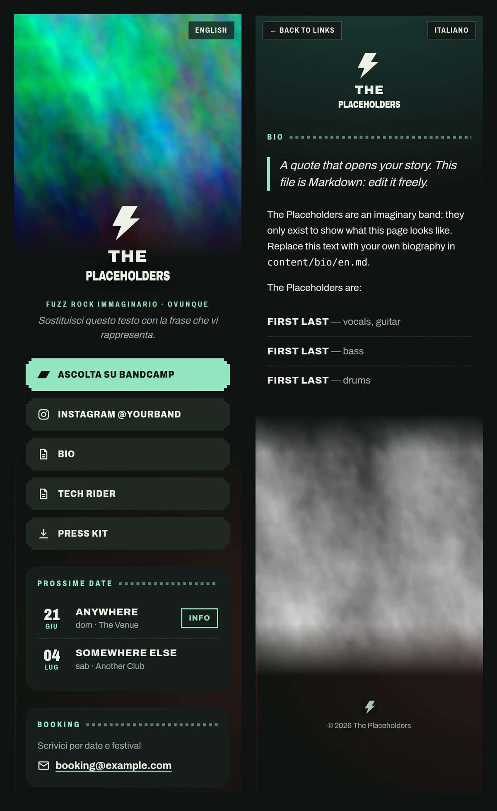

# bdtree

**bdtree** is a link-in-bio page for bands, an open-source alternative to Linktree that you host yourself for free.
Built with [Eleventy](https://www.11ty.dev/) and deployed to Firebase Hosting.

<p align="center"></p>

- Italian at `/`, English at `/en/`, with a language switch on every page
- Link buttons (streaming, socials, downloads), one of them highlighted
- Upcoming gigs: past dates disappear automatically at build time
- Booking contact
- Bio page written in Markdown
- Downloadable tech rider and press kit
- Share previews (Open Graph) for Instagram, WhatsApp and similar apps; no client-side JavaScript on the public pages; about 150 KB per page
- Optional `/admin/` editor: bandmates sign in with Google and edit gigs, links, bio and texts with forms, each save a git commit

bdtree comes from a real band: it was built for [BrokenSlide](https://brokenslideband.web.app), a psych garage blues trio, and it runs their site every day.
That's the live example; the code here is generic, and the band's own content lives in a separate private repo.

To start your own, use the template [bdtree-the-placeholders](https://github.com/batdevis/bdtree-the-placeholders): a content repo with a demo band and the GitHub Actions deploy ready.

## How it works

The code and the band content are kept apart:

```
.
├── src/          templates, CSS (the code)
├── example/      a fictional demo band, used when there is no content/
├── content/      YOUR band (gitignored, keep it in its own private repo)
└── scripts/      deploy + press kit helpers
```

The build reads content from `$CONTENT_DIR`, else `content/`, else `example/`.

## Make it yours

The recommended start is the template content repo, [bdtree-the-placeholders](https://github.com/batdevis/bdtree-the-placeholders): **Use this template** gives you your own (private) content repo, with the demo band and a workflow that deploys on every push. Its README walks you through the setup, Firebase and CI included.

To just try bdtree locally, copy the demo band instead:

```sh
git clone <this-repo> my-band-page
cd my-band-page
npm install
cp -r example content      # start from the demo band
npm start                  # http://localhost:8080, live reload
```

Then edit `content/`:

| File | What |
| --- | --- |
| `band.json` | name, `siteUrl`, `firebaseProject`, genre, tagline, booking email, link buttons |
| `gigs.json` | live dates: `{ "date": "YYYY-MM-DD", "city", "venue", "url" }` (`url` is optional and opens in a new tab) |
| `i18n.json` | page texts in both languages |
| `bio/it.md`, `bio/en.md` | biography in Markdown: quotes (`>`), **bold**, lists, links |
| `img/` | `logo.svg` (inlined; use `fill="currentColor"` so it takes the text color), `favicon.svg`, `band.jpg/.webp` (home photo), `bio.jpg/.webp`, `og.jpg` (1200×630 share image) |
| `press/` | any files to link, e.g. the tech rider |
| `theme.css` | optional: override the colors (see the `:root` variables at the top of `src/assets/css/style.css`) |

Link buttons in `band.json` take `label` (`it`/`en`), plus `url` for external links or `page` for a page of this site (e.g. `/bio/`).
Optional flags: `featured: true` highlights the button, `newTab: true` opens it in a new tab.
The `id` picks the icon (`bandcamp`, `instagram`, `presskit`; anything else gets a document icon). Icons live in `src/_includes/icons.njk`.

To keep your content versioned without making it public, turn `content/` into its own private git repository:

```sh
cd content && git init && git add . && git commit -m "Band content"
```

You can also keep the content repo next to the code instead of inside it, and link it:

```sh
# my-band/bdtree           ← this repo
# my-band/my-band-content  ← your private content repo
cd my-band/bdtree && ln -s ../my-band-content content
```

### Press kit

Zip a folder of press material into `content/press/<BandName>-press-kit.zip`. JPEG photos are shrunk to 2400 px on the longest side:

```sh
KIT_DIR=/path/to/press/folder npm run presskit
```

## Deploy (Firebase Hosting, free Spark plan)

First time only:

```sh
npx firebase-tools login
npx firebase-tools projects:create <project-id>     # or create one in the Firebase console
```

Set `firebaseProject` to `<project-id>` and `siteUrl` to `https://<project-id>.web.app` (or your custom domain) in `content/band.json`. Then, each time:

```sh
npm run deploy
```

Gigs are filtered when the site is built, so redeploy after a show to remove it from the list.
To add a custom domain: Firebase console → Hosting → Add custom domain.

## Admin editor (optional, needs the Blaze plan)

`/admin/` is a page where you and your bandmates sign in with Google and edit gigs, links, bio and page texts with forms. Images are still changed by hand.
On save, a Cloud Function commits the changes to your content repo on GitHub. Your content repo then has to rebuild and deploy on push, e.g. with a GitHub Actions workflow that checks out this repo plus your content and runs `npm run deploy`.
Git stays the source of truth: every save is a normal commit, with the editor as its author.

The public pages stay JavaScript-free. Only `/admin/` loads the Firebase SDK, and it reads the project config from Hosting's reserved `/__/firebase/init.json`.

First time only:

1. Switch the Firebase project to the **Blaze** plan. A small band site stays in the free tier, but setting a budget alert is a good idea.
2. Firebase console → Authentication → Sign-in method → enable **Google**.
3. On GitHub, create a fine-grained personal access token with access to **only your content repo** and the permission **Contents: read and write**. Store it as a secret:
   ```sh
   npx firebase-tools functions:secrets:set GITHUB_TOKEN --project <project-id>
   ```
4. Copy `example/functions.env` to `content/functions.env` and set your repo and the Google accounts allowed to edit.
5. Deploy the functions. Run this again whenever `functions/` or `functions.env` changes:
   ```sh
   npm run deploy:functions
   ```
6. Deploy the site as usual (`npm run deploy`, or push your content repo) to publish `/admin/`.

If two people save at the same time, the second one is asked to reload, so nothing is overwritten.
If the page says the GitHub token is invalid or expired, create a new one (step 3) and store it again. `--force` also redeploys the functions with it:

```sh
printf %s "$GITHUB_TOKEN" | npx firebase-tools functions:secrets:set GITHUB_TOKEN --data-file=- --force --project <project-id>
```

Piping avoids pasting into the hidden prompt, which can store a truncated value.

## License

The code and the `example/` demo band are licensed under [MIT](LICENSE).
Your own `content/` stays yours: it isn't part of this repository.
